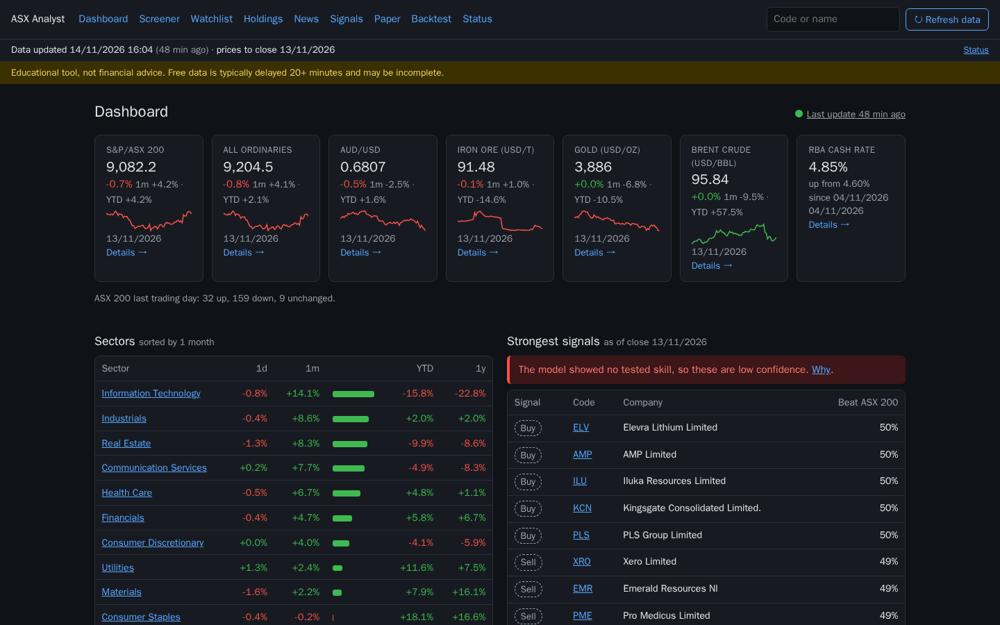
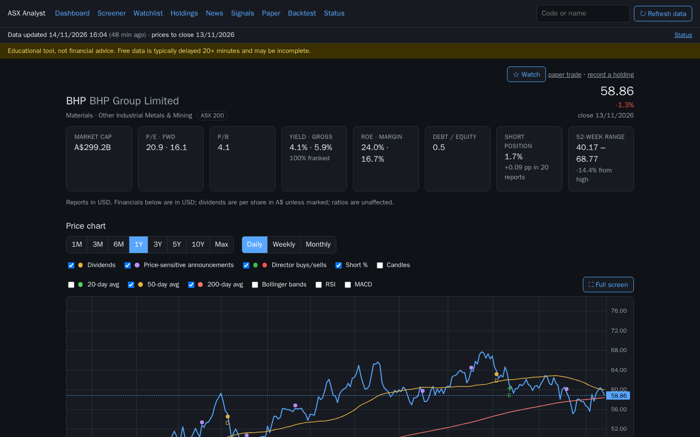
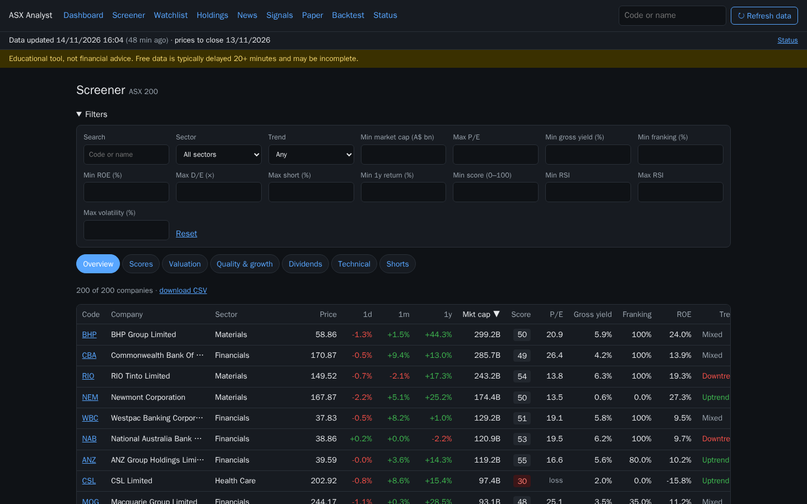
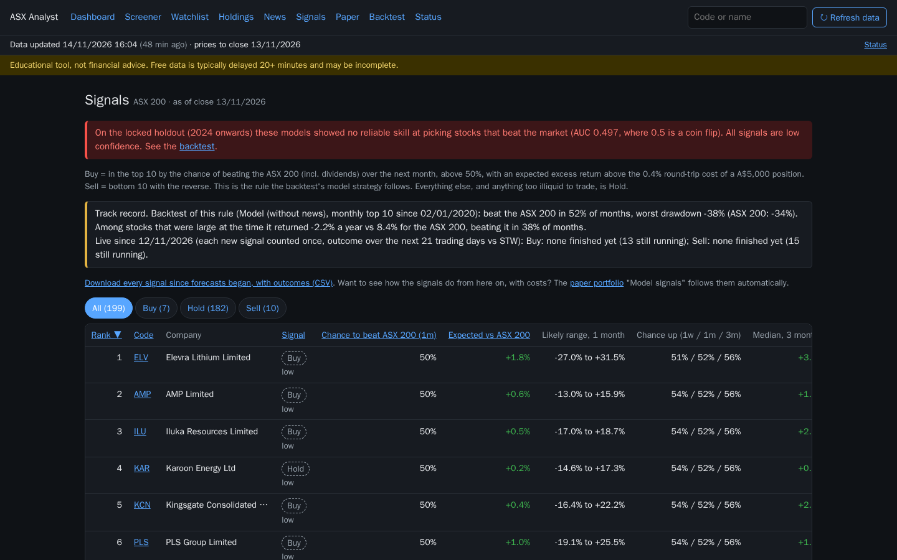
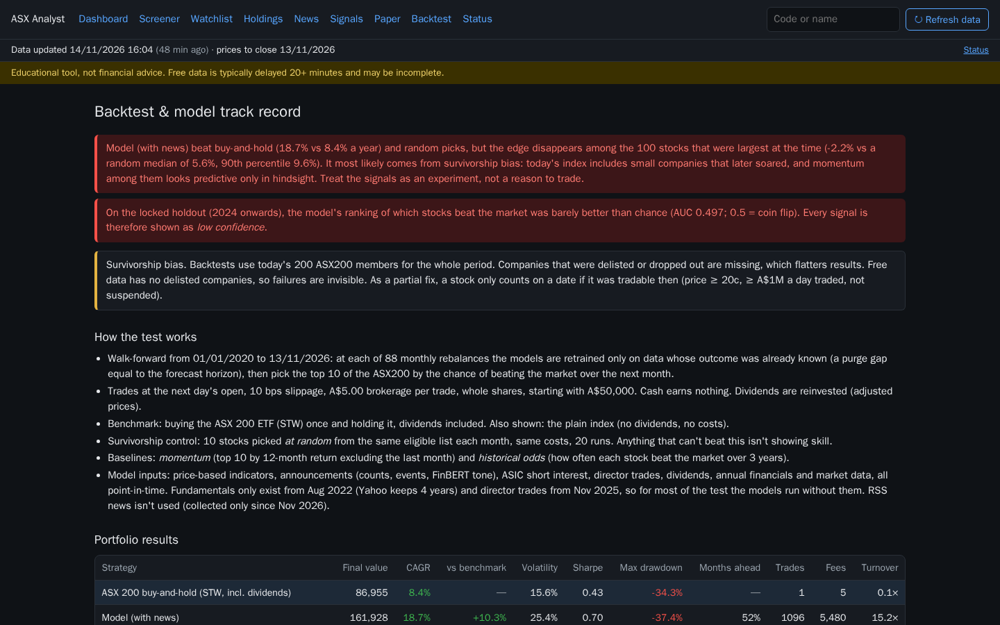
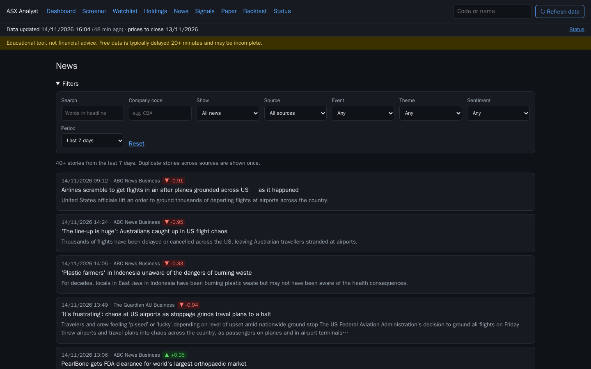

# ASX Analyst

Self-hosted ASX research dashboard for your home network. It collects free market data, ASX announcements, ASIC short positions and RBA data, scores news, forecasts return ranges and shows Buy/Hold/Sell signals with the evidence and honest backtests behind them, plus a watchlist, paper trading, your real holdings (P&L, dividends, CGT discount dates), alerts and CSV export.

**Educational tool, not financial advice.** It never connects to a broker or places trades. Free data is delayed 20+ minutes.

## Screenshots
| Dashboard | Company page |
|---|---|
|  |  |
| **Screener** | **Signals** |
|  |  |
| **Backtest** | **News** |
|  |  |

## Requirements
- Docker with Compose v2. Nothing else is installed on the host.
- ~1 GB of image space; `./data` grows to roughly 1–2 GB after the initial backfill.

## Setup
```bash
git clone https://github.com/fipity/asx-analyst.git
cd asx-analyst
cp .env.example .env        # optional: edit settings
docker compose up -d --build
```
Open `http://<server-ip>:8000` from any device on your LAN.

On first start the app backfills history in the background: 10+ years of prices, 10 years of announcements, 10 years of ASIC short reports and 1 year of director notices. This takes about 1–2 hours. Progress is shown on the **Status** page; the app is usable meanwhile.

LAN only: don't forward the port on your router. To require a password, set `APP_PASSWORD=...` in `.env` and run `docker compose up -d`.

## Pages
- **Dashboard** (`/`): ASX 200, All Ords, AUD/USD, iron ore, gold, oil (with 3-month lines) and the RBA cash rate; sector performance; how many stocks rose or fell; the strongest Buy/Sell signals; biggest movers; market news and price-sensitive announcements; your watchlist and paper portfolios; a health dot linking to Status.
- **Screener** (`/screener`): every stock in your universe with returns, valuation, gross (franked) yield, ROE, debt, short %, fundamental scores and technical indicators. Switch column sets with the tabs (Overview, Scores, Valuation, Quality & growth, Dividends, Technical, Shorts). Filter by sector, trend and thresholds; click a column to sort. The URL keeps your filters, so bookmark it.
- **Company** (`/company/BHP`, or type a code in the top search box): price chart with dividends, price-sensitive announcements, director buys/sells and short % (hover or tap a day for details), moving averages, Bollinger bands, RSI and MACD on request, fundamental scores with the metrics behind them, a plain-English technical summary, returns vs sector and ASX 200, dividends with franking, calendar, annual financials, peers, director trades and announcements.
- **News** (`/news`): headlines from ABC, The Guardian, SMH, Motley Fool and the RBA, with linked companies, event and theme tags and FinBERT sentiment. Filter by company, source, event, theme, sentiment and period. Duplicate stories are shown once.
- **Watchlist** (`/watchlist`): add codes here or with ☆ Watch on any company page. Shows price moves, the current signal, news count and tone, the next dividend/earnings date and the latest price-sensitive announcement, plus a combined announcements and news feed.
- **Holdings** (`/holdings`): enter the shares you own (buys and sells with date, price and brokerage; nothing connects to a broker). Shows value, unrealised and realised P&L, dividends received with franking credits, a comparison with putting the same money into the ASX 200 ETF on the same days, concentration by stock and sector (warnings above 20% in one stock or 40% in one sector), and every parcel with the date it qualifies for the 50% CGT discount. When a Sell signal appears on something you hold, a banner says whether selling now would miss the discount. Parcels are matched first-in, first-out. General information, not tax advice.
- **Alerts** (`/alerts`, linked from Status): where alerts go, quiet hours, a test button and the alert history.
- **Paper** (`/paper`): practise with pretend money. Create portfolios, place market orders (by shares or A$ amount); they fill at the next session's opening price once that day's prices are in, with brokerage and slippage, and dividends are credited on the ex-date. Each portfolio is compared with buying the ASX 200 ETF (STW) on the same day with the same costs. A "Model signals" portfolio is created automatically and follows the model exactly like the backtest (top 10, rebalanced every 20 trading days) from the day it started, so its record is genuinely out of sample.
- **Signals** (`/signals`): Buy/Hold/Sell for each stock with the chance of beating the ASX 200 over a month, likely return ranges for 1 week, 1 month and 3 months, and a confidence label capped by the model's tested skill. Next to them: the backtest hit rate and worst drawdown of the signal rule, and the live record of every signal issued since forecasts began (each new signal checked against the ASX 200 over the following 21 trading days). Company pages list that stock's signal history with outcomes.
- **Backtest** (`/backtest`): how the models and two simple baselines would have done since 2020 against buying and holding the ASX 200, after brokerage and slippage, plus forecast-quality and calibration tables. Read this before trusting any signal.
- **Status**: an overall health summary, data freshness per dataset (flagged when older than expected), every job with what it does, when it runs, last run, duration, last success and next run (with a Run button), disk and memory use, backups, sources, recent errors, Refresh button.

### Alerts
Off until you set a channel in `.env`, then `docker compose up -d`:
- **ntfy**: `NTFY_URL` (e.g. `https://ntfy.sh` or your own server), `NTFY_TOPIC`, optional `NTFY_TOKEN`. Subscribe to the topic in the ntfy phone app.
- **Webhook**: `WEBHOOK_URL` receives a JSON POST with `title`, `body`, `text`, `url`, `kind`, `code`, `priority`.

You get an alert when the signal changes on a watchlist or held stock (after the 4:10pm update; held stocks with a Sell include the CGT note), when a price-sensitive announcement lands for one of them (checked every 30 minutes in market hours), and when a scheduled job fails (at most once per job per 6 hours). Turn kinds off with `ALERT_SIGNALS`, `ALERT_ANNOUNCEMENTS`, `ALERT_JOBS`. During quiet hours (`QUIET_HOURS_START`–`QUIET_HOURS_END`, default 22:00–07:00 Sydney) alerts wait and go out when they end. Set `APP_URL` (e.g. `http://<server-ip>:8000`) to make alerts link back to the app. Each alert is sent once.

### AI summaries (optional)
With an Anthropic API key, the app writes a short plain-English summary of each new price-sensitive announcement for stocks on your watchlist or in your holdings: what happened, up to four key numbers, event type and tone. It reads the announcement PDF (first 15 pages) and stores only the summary. Summaries appear under the announcement on company pages and the watchlist, and inside announcement alerts.

1. Create a key at console.anthropic.com (API keys), and add credit.
2. Add `LLM_API_KEY=...` to `.env`, then run `docker compose up -d`.

Defaults: `LLM_MODEL=claude-haiku-5-5` (about US$0.002 per summary), `LLM_SCOPE=followed` (`universe` covers every index member, typically 20–60 announcements a day), `LLM_DAILY_LIMIT=40`. The Status page shows the last 30 days' usage and estimated cost. A summary can contain mistakes, so open the PDF before acting on it.

### Corporate actions in Holdings
Besides buys and sells, the Holdings form takes **DRP** (shares from a dividend reinvestment plan), **capital return** (lowers your cost base; any excess over it is a capital gain), and **demerger** (new shares per share held plus the % of cost base the company's tax statement moves across; the new shares keep your purchase dates for the CGT discount). Enter a cash takeover as a sell, and scrip-for-scrip as a sell plus a buy (no roll-over relief). Splits and consolidations are automatic. Stocks you hold outside the index get their prices downloaded as soon as you add them.

### ASX holidays
The app knows the ASX trading calendar: New Year's Day, Australia Day, Good Friday, Easter Monday, Anzac Day (not moved when it falls on a weekend), King's Birthday, Christmas and Boxing Day, with the weekend substitutions. It was checked against every trading day from 2014 to 2026. Daily updates skip holidays, paper orders roll to the next trading day, and data-freshness checks count trading days. If the ASX announces an extra closure, add it to `ONE_OFF` in `app/market_calendar.py`.

### CSV export
Download links on the pages: screener (with your current filters), every signal since forecasts began with its outcome (Signals page), paper-portfolio orders (Paper page), and holdings positions/parcels, trades, realised gains and dividends (Holdings page).

### Scores and indicators
Scores (0–100) rank each company within its sector on **valuation** (earnings, forward earnings, book and free-cash-flow yields), **quality** (ROE, margin, debt, profit record), **growth** (latest and multi-year revenue and EPS growth) and **dividend** (gross yield, franking, dividend growth, consistency). 50 is the sector middle; small sectors are blended towards the whole index. They describe reported numbers and are not forecasts. Technical indicators and the trend label are descriptive too. Both are recalculated after every daily update.

### Forecasts and backtests
Every Saturday at 02:00 the app rebuilds point-in-time features, runs a purged walk-forward backtest from 2020 (models retrained monthly on data whose outcomes were already known), measures forecast quality against simple baselines, then fits the models used for the daily signals. It takes about 20 minutes on 2 cores at low priority. Daily forecasts refresh at the end of the 16:10 update. Settings: `PAPER_CAPITAL`, `BACKTEST_TOP_N`, `BROKERAGE_PER_TRADE`, `SLIPPAGE_BPS`, `BACKTEST_START`.

Known limits, also shown in the app: survivorship bias (only today's index members; delisted companies have no free data), fundamentals only from 2022, director trades only from Nov 2025, no RSS news in the models, cash earns nothing.

### News sentiment model (one-off)
Sentiment uses [FinBERT](https://huggingface.co/ProsusAI/finbert) (licence CC-BY-NC-SA-4.0, fine for personal use) run with onnxruntime, so the app image has no PyTorch. Build the model once (about 2 minutes; a temporary container downloads PyTorch, converts the model and is deleted):
```bash
./tools/install-finbert.sh      # writes data/models/finbert (~440 MB)
docker compose restart
```
Without it, everything works except sentiment. After installing, the app scores all stored announcement headlines in the background (about 15 minutes, low priority).

## Settings (`.env`)
| Setting | Default | Meaning |
|---|---|---|
| `APP_PORT` | 8000 | Host port |
| `BIND_IP` | 0.0.0.0 | Host address to listen on (set to the LAN IP to bind one interface) |
| `APP_PASSWORD` | empty | Optional login password |
| `INDEX_UNIVERSE` | asx200 | `asx50`, `asx100`, `asx200` or `asx300` (100/300 are labelled approximations) |
| `BROKERAGE_PER_TRADE` | 5.0 | AUD per trade in backtests and paper trading |
| `SLIPPAGE_BPS` | 10 | Extra cost per trade in backtests and paper trading |
| `PAPER_CAPITAL` | 50000 | Starting cash of backtests and the model paper portfolio (default for new paper portfolios) |
| `BACKTEST_TOP_N` | 10 | Stocks held by the model strategy, Buy/Sell list size |
| `BACKUP_KEEP` | 4 | Weekly automatic database backups kept (0 = off) |
| `ANNOUNCEMENT_BACKFILL_YEARS`, `ASIC_BACKFILL_YEARS`, `DIRECTOR_TRADES_BACKFILL_DAYS` | 10, 10, 365 | Backfill depth |
| `RATE_LIMIT_SECONDS` | 1.0 | Minimum gap between requests to the same host |
| `LLM_API_KEY` | empty | Anthropic API key for AI announcement summaries (off by default) |
| `LLM_MODEL`, `LLM_SCOPE`, `LLM_DAILY_LIMIT` | claude-haiku-5-5, followed, 40 | Model, which announcements, daily cap |
| `NTFY_URL`, `NTFY_TOPIC`, `NTFY_TOKEN`, `WEBHOOK_URL` | empty | Alert channels (off by default) |
| `QUIET_HOURS_START`, `QUIET_HOURS_END` | 22:00, 07:00 | No alerts in between (Sydney time); they're sent afterwards |
| `ALERT_SIGNALS`, `ALERT_ANNOUNCEMENTS`, `ALERT_JOBS` | true | Which alerts to send |
| `APP_URL` | empty | Base URL for links in alerts |

After changing `.env`: `docker compose up -d` (recreates the container).

## Day-to-day
- **Refresh now:** Status page → *Refresh data*, or `curl -X POST http://<ip>:8000/api/refresh`.
- **Schedule** (Sydney time): full update on ASX trading days at 16:10 (skipped on weekends and ASX public holidays) (ends with forecasts and paper-order fills); ASX announcements + news every 30 min 10:00–16:00, hourly otherwise; ASIC shorts 09:05; model retraining Saturday 02:00; backup + maintenance Sunday 03:30; constituents Sunday 06:00. If the app was stopped over a 16:10 slot, the missed update runs 2 minutes after it starts again; if the last training is more than 8 days old, training runs 5 minutes after start.
- **Logs:** `docker compose logs -f` (rotated: 3 × 10 MB).
- **Health:** `docker compose ps` shows `(healthy)`; endpoint `/healthz`.

## Update the app
```bash
cd asx-analyst
git pull            # or edit locally
docker compose up -d --build
```
Database migrations run automatically on start. Data in `./data` is kept.

## Backup
Everything stateful is in `./data` (`asx.db` SQLite database, `models/`, `cache/`, `secret.key`).

**Automatic:** every Sunday at 03:30 the app writes a consistent, gzipped copy of the database to `data/backups/asx-auto-<date>.db.gz` and keeps the last `BACKUP_KEEP` (default 4; `0` turns it off). Other files in `data/backups` are never touched. These copies sit on the same disk as the live database, so copy them elsewhere now and then (another machine, a USB drive). To restore one: `docker compose stop`, `gunzip -c data/backups/asx-auto-….db.gz > data/asx.db`, delete `data/asx.db-wal` and `data/asx.db-shm` if present, `docker compose start`.

**Manual:**

Consistent online backup (safe while running):
```bash
cd asx-analyst
mkdir -p backups
docker compose exec asx-analyst python -c "import sqlite3; s=sqlite3.connect('/app/data/asx.db'); d=sqlite3.connect('/app/data/backup.db'); s.backup(d); d.close()"
tar czf backups/asx-data-$(date +%F).tgz -C data backup.db models secret.key 2>/dev/null; rm -f data/backup.db
```
`cache/` doesn't need backing up (it's re-downloadable). Restore: stop the app, put `asx.db` (renamed from `backup.db`) back in `./data`, start the app.

Simple cold backup: `docker compose stop && tar czf asx-data-$(date +%F).tgz data && docker compose start`.

## Tests
```bash
docker compose run --rm --no-deps -v "$PWD:/app" asx-analyst pytest
```

## Data sources
Yahoo Finance via yfinance (unofficial, personal use), ASX announcements and company data (asx.com.au), SPDR/iShares ETF holdings for index constituents, ASIC short position reports, RBA statistical tables. Google News RSS is not used (its robots.txt disallows it). See PLAN.md for details and limitations.

Note: this container uses public DNS (1.1.1.1 / 8.8.8.8) because the LAN DNS blocks `fc.yahoo.com`, which Yahoo needs for fundamentals.

## License
MIT (see `LICENSE`). FinBERT, which `tools/install-finbert.sh` downloads separately, is CC-BY-NC-SA-4.0.
